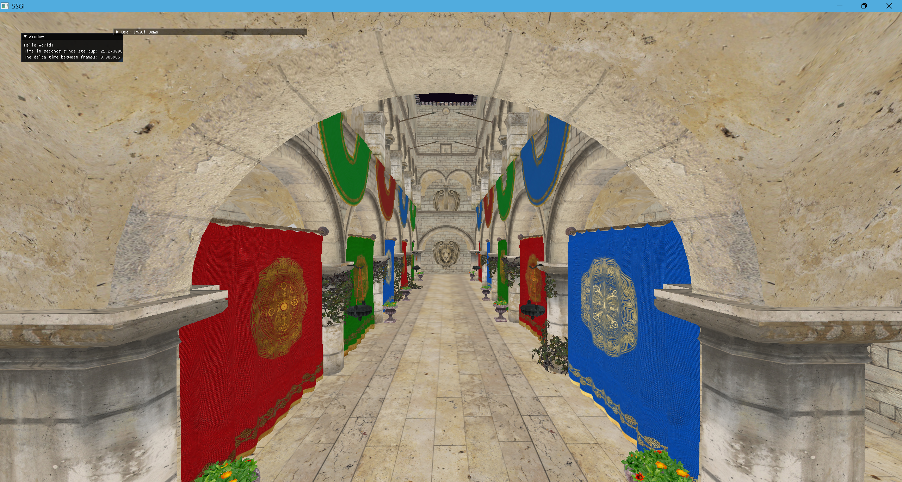

# CMake-Glfw-OpenGL-Template

## What is this?

CMake based C++ Project template with support for glfw, glad, imgui, spdlog, tracy, stbi, cgltf

This template is from https://github.com/deccer/CMake-Glfw-OpenGL-Template

## What you need:

- `CMake`
- for VSCode the `CMake Tools` extension from Microsoft
- a compiler of your choice (Clang, GCC, MSVC)

This project template assumes OpenGL 4.6 support
